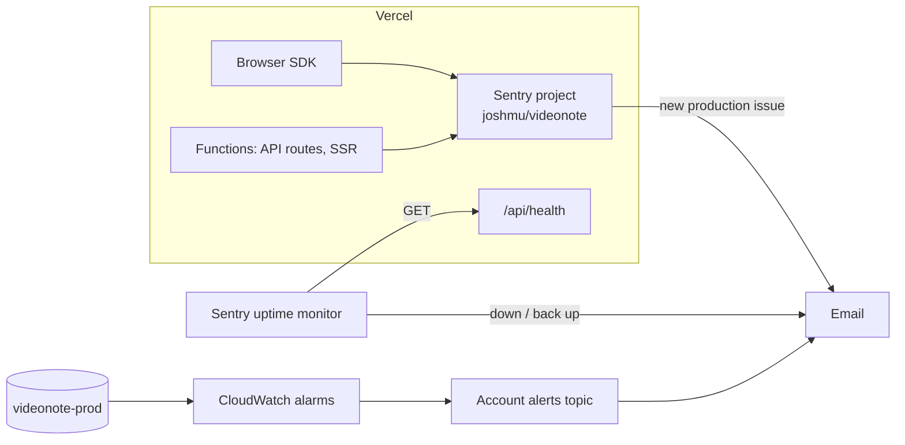

# Observability

How VideoNote reports trouble, where each signal lands and what to do when
one fires. Everything here runs on free tiers.



## Signals

| Signal                                  | Catches                                                                                                      | Lands in                                                                  |
| --------------------------------------- | ------------------------------------------------------------------------------------------------------------ | ------------------------------------------------------------------------- |
| Sentry, server SDK                      | Errors that escape a route (`onRequestError`), and errors a route catches and answers itself (`reportError`) | Sentry issues, tagged by environment                                      |
| Sentry, browser SDK                     | Uncaught errors and unhandled rejections in the browser                                                      | Sentry issues                                                             |
| Sentry, `pages/_error.tsx`              | Errors while rendering a page on the server                                                                  | Sentry issues                                                             |
| Sentry uptime monitor                   | `/api/health` failing or unreachable on videonote.app                                                        | Sentry uptime, emails on down and recovery                                |
| CloudWatch alarms (`infra/`, prod only) | Any throttled request; read or write use above 80% of provisioned capacity for 5 minutes                     | The account alerts topic, which emails the owner on alarm and on recovery |
| Vercel runtime logs                     | Everything functions print, including `reportError`'s `console.error`                                        | Vercel dashboard (short retention on Hobby)                               |

`/api/health` reads a User id that never exists. A 200 means the function
could assume its AWS role and reach its table; a 503 means it couldn't, and
the error goes to Sentry.

## Configuration

- **SDK:** `@sentry/nextjs`. Shared options live in `sentry.options.ts`,
  loaded by `instrumentation-client.ts` (browser) and `sentry.server.config.ts`
  (server, registered from `instrumentation.ts`).
- **On or off:** Sentry runs only where `NEXT_PUBLIC_SENTRY_DSN` is set. Vercel
  sets it for every environment; local dev, tests and CI leave it unset, so
  nothing is sent. To try Sentry locally, put the DSN in `.env.local`; events
  arrive tagged `development`.
- **Environment tag:** `NEXT_PUBLIC_SENTRY_ENVIRONMENT`, set in Vercel to
  `production` or `preview`. Alerts only fire for `production`.
- **Release:** the git commit SHA, so an issue shows which deploy introduced it.
- **Source maps:** uploaded at build time where `SENTRY_AUTH_TOKEN` is set
  (Vercel, through the Sentry integration) and not served to browsers.
- **Tracing:** 10% of requests.
- **Not collected:** request bodies (they hold Notes and Share passwords),
  cookies, local variables, console output (it logs Notes and video URLs),
  database query data, IP addresses and emails.
  Signed-in requests carry the User id only (`withAuthenticatedUser`). The
  Sentry project also scrubs IP addresses, `email` fields and the default
  sensitive keys server-side.
- **No Session Replay.**

## When something fires

| Alert                         | First look                                                                                                                                   |
| ----------------------------- | -------------------------------------------------------------------------------------------------------------------------------------------- |
| New Sentry issue (production) | `sentry issue view <ISSUE-ID>`, then `sentry issue explain <ISSUE-ID>`; reproduce in a test before fixing                                    |
| Uptime down                   | `curl -i https://videonote.app/api/health`; the matching Sentry issue holds the error; check the Vercel deployment and the AWS role          |
| `videonote-prod-throttled`    | Requests are being rejected. Find the hot path in Sentry traces; raising capacity means revisiting the free-tier budget in `infra/README.md` |
| `*-capacity-high`             | Traffic is near the provisioned limit. Same budget question, before it throttles                                                             |

## Sentry CLI

```bash
brew install getsentry/tools/sentry
sentry auth login
sentry issue list joshmu/videonote
```

Don't open GitHub issues from Sentry automatically: the repo is public and
Sentry would copy error details into them. Open one by hand when an issue
needs work.

## Limits

Sentry's free Developer plan has one user, a monthly event quota, 30-day
retention and one uptime monitor ([pricing](https://sentry.io/pricing/)). Over quota, Sentry drops events rather than billing
(pay-as-you-go is $0). CloudWatch's free tier covers 10 alarms per account,
and the alerts topic's email covers 1,000 notifications a month.
