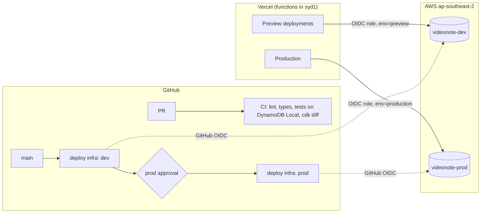
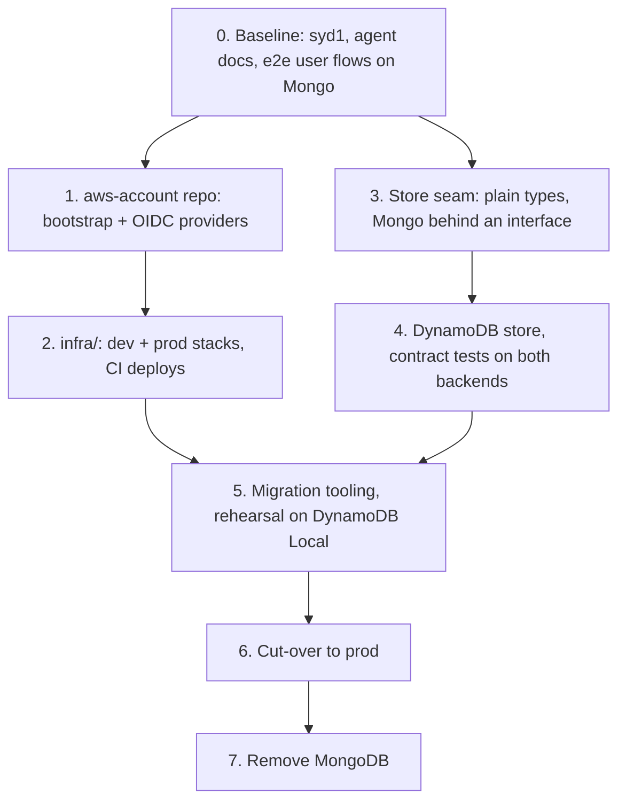

# Plan: move VideoNote from MongoDB to DynamoDB

Status: done. The migration commands (`scripts/migrate/`) were removed with MongoDB; git history keeps them ([#176](https://github.com/joshmu/videonote/pull/176)).

## Goal

VideoNote runs on Amazon DynamoDB in `ap-southeast-2`, with separate dev and
prod environments deployed from this repo, and no MongoDB dependency left in
the code. Users notice nothing: sessions, share links and data carry over.

Non-goals: redesigning the app or its API. Architecture improvements come
after this plan, on top of the test harness it leaves behind (see
[Later](#later)).

## Why

- **One less vendor.** Hosting is Vercel, DNS and assets are Cloudflare, and the
  rest of the personal stack is moving to AWS. MongoDB Atlas is the odd one out.
- **Same cost.** Atlas M0 is free and so is this: DynamoDB's always-free tier
  (25 GB, 25 RCU and 25 WCU of provisioned capacity per region) is orders of
  magnitude above VideoNote's data and traffic. Provisioned capacity throttles
  instead of billing when exceeded.
- **Latency.** The database is in Sydney but the Vercel functions run in
  `sfo1`, so every query crosses the Pacific. Pinning functions to `syd1`
  (Phase 0) fixes that independently of the migration.

## Target architecture

- **No long-lived AWS keys anywhere.** Vercel functions and GitHub Actions both
  assume IAM roles with short-lived OIDC tokens. Each Vercel role trusts only
  its own environment's token (`sub` ends in `environment:production` or
  `environment:preview`), so a preview deployment cannot reach prod data.
- **Account-wide pieces live in a separate private repo** (`joshmu/aws-account`):
  the CDK bootstrap and the GitHub and Vercel OIDC identity providers. An AWS
  account can hold only one provider per issuer, so these can't belong to any
  single app. App stacks look them up from SSM parameters.
- **Infrastructure is AWS CDK in TypeScript**, in `infra/` here, as two stacks:
  `VideonoteDev` and `VideonoteProd`.

## Data model

One table per environment, keys `PK` / `SK` (strings), no secondary indexes.
Ids stay 24-character hex ObjectIds (generated with `bson`), so existing
session tokens, share tokens, URLs and the client's id validation keep working.

| Item            | PK                    | SK              | Attributes                                                                                             |
| --------------- | --------------------- | --------------- | ------------------------------------------------------------------------------------------------------ |
| User            | `USER#<userId>`       | `PROFILE`       | `email`, `username`, `passwordHash`, `role`, `projectIds` (ordered list), `settings` (map), timestamps |
| Email claim     | `EMAIL#<email>`       | `EMAIL`         | `userId`                                                                                               |
| Project         | `PROJECT#<projectId>` | `PROJECT`       | `ownerId`, `title`, `src`, `share` (map: `shareId`, `url`, `canEdit`, `passwordHash`), timestamps      |
| Note            | `PROJECT#<projectId>` | `NOTE#<noteId>` | `content`, `time`, `done`, `authorId?`, timestamps                                                     |
| Note claim      | `NOTE#<noteId>`       | `NOTE`          | `projectId`                                                                                            |
| Share URL claim | `SHARE#<url>`         | `SHARE`         | `projectId`, `shareId`                                                                                 |

Claim items enforce what Mongo's unique indexes did (email, share url, note id)
through conditional writes in a transaction, and give id-only lookups without
a secondary index (whose capacity would eat into the free tier).

- `User.projectIds` replaces `User.projects` and keeps its order, which the
  dashboard depends on. Project order does not follow id order in live data,
  so the order can't be derived from the keys.
- Settings fold into the User item. They're 1:1 and always read with the user.
- Note order doesn't matter: the client sorts Notes by `time`.
- A deleted author's Notes keep `authorId`. The author lookup finds no user, so
  the note reads as a guest's, the same result as today's `$unset`.

### Access patterns

| Operation                 | Today (Mongoose)                          | DynamoDB                                                                                                       |
| ------------------------- | ----------------------------------------- | -------------------------------------------------------------------------------------------------------------- |
| Session lookup            | `User.findById`                           | `GetItem USER#id`                                                                                              |
| Login                     | `User.findOne({ email })`                 | `GetItem EMAIL#…`, then `GetItem USER#…`                                                                       |
| Register                  | `User.create` + unique index              | `TransactWrite`: put email claim (must not exist), put user                                                    |
| Change email              | `save` + unique index                     | `TransactWrite`: put new claim, delete old, update user                                                        |
| Dashboard (`/api/auth`)   | `Project.find` + populate                 | one `Query PROJECT#id` per `projectIds` entry, in parallel, plus `BatchGet` of note authors                    |
| Get or update own project | `findOne({ _id, user })`                  | `Query PROJECT#id`, check `ownerId`                                                                            |
| Write note                | `Note.findById` → create or save          | `GetItem NOTE#id` claim → update in place, or `TransactWrite` claim + note + condition that the project exists |
| Remove done notes         | `deleteMany` + `$pull`                    | `Query` notes where `done`, `BatchWrite` deletes (notes and claims)                                            |
| Open share                | `Share.findOne({ url })`                  | `GetItem SHARE#url` → `Query PROJECT#id`, check `share.shareId` matches                                        |
| Share / unshare           | `Share` create or delete + `Project.save` | `TransactWrite`: url claim + project `share` map                                                               |
| Remove project            | cascade (notes, share, ref, project)      | same order and idempotence: notes and claims, url claim, `projectIds` entry, project item last                 |
| Remove account            | cascade projects, shares, settings, user  | cascade projects, delete email claim, delete user                                                              |
| Settings                  | `Settings` doc                            | `UpdateItem` on the user's `settings` map                                                                      |

Reads that follow a write in the same request (the "reload for caller" paths)
use strongly consistent reads.

### Capacity and cost

The always-free capacity is shared by every table in the region, so it's split:

| Table            | RCU | WCU | Notes                                                                       |
| ---------------- | --- | --- | --------------------------------------------------------------------------- |
| `videonote-prod` | 20  | 20  | point-in-time recovery on, deletion protection on, `RETAIN` on stack delete |
| `videonote-dev`  | 2   | 2   | previews only; local dev and CI use DynamoDB Local                          |
| spare            | 3   | 3   | headroom for future projects                                                |

The heaviest request, a dashboard for the largest account, needs roughly
40 RCU in one go. DynamoDB's burst capacity (up to 5 minutes of unused
capacity) covers that, and the SDK retries any throttling. Auto scaling stays
off so capacity, and cost, can't grow.

Expected bill: $0, plus well under $0.01/month for point-in-time recovery on a
few megabytes. The account's budget alerts stay in place.

## Local development and the feedback loop

| Loop                          | Command                                                       | Backed by                                                                    |
| ----------------------------- | ------------------------------------------------------------- | ---------------------------------------------------------------------------- |
| Unit and server tests (watch) | `pnpm test`                                                   | DynamoDB Local container started by the vitest global setup (testcontainers) |
| App                           | `pnpm db:up && pnpm db:seed && pnpm dev`                      | DynamoDB Local, generated seed data; no AWS needed                           |
| App against real AWS          | `pnpm dev:aws`                                                | `videonote-dev` through the `AWS_PROFILE` you name                           |
| End-to-end user flows         | `pnpm test:e2e`                                               | production build + DynamoDB Local, Playwright                                |
| Infra                         | `pnpm infra:test`, `pnpm infra:diff`, `pnpm infra:deploy:dev` | CDK assertions, then the dev stack                                           |

Seed data is generated, never copied from production. CI runs the same
container image as local runs.

## Phases

Each phase is one or more PRs. CI and the end-to-end suite stay green at every
step. The app keeps working on MongoDB until the cut-over.

### 0. Baseline

- `vercel.json` with `"regions": ["syd1"]`.
- `AGENTS.md` (with `CLAUDE.md` importing it) and a `docs/` index.
- **End-to-end user flows** with Playwright against a local production build,
  run in CI: register, log in, expired session, create, rename and remove a
  project, add, edit, tick and clear notes, settings, share open,
  password-protected and editable, guest notes on a share, unshare, remove
  account. These run on MongoDB first, so they define "works" before anything
  moves.
- **Share check.** An old report said sharing was broken. The share flows above
  settle it. Anything broken is fixed in its own PR before Phase 3, so the
  migration starts from a known-good baseline.

### 1. Account foundation (`joshmu/aws-account`, private)

- A CDK app with one stack: the GitHub OIDC provider, the Vercel OIDC provider
  (team issuer), and SSM parameters exposing their ARNs.
- CDK bootstrap for `ap-southeast-2`.
- Deployed from a workstation with SSO. Changes are rare and account-wide. CI
  runs synth and tests only.

### 2. VideoNote infrastructure (`infra/`)

- Stacks `VideonoteDev` and `VideonoteProd`: the table, the Vercel role for the
  environment (DynamoDB item actions on that table only), and the GitHub deploy
  role (trusted for `repo:joshmu/videonote:environment:<env>`).
- GitHub Actions: `cdk diff` for both stacks on every PR; on `main`, deploy dev
  and then prod behind the `prod` environment's required reviewer.
- Vercel environment variables per environment: `AWS_ROLE_ARN`, `AWS_REGION`,
  `DYNAMODB_TABLE`. OIDC federation switched on (team issuer).

### 3. Store seam

- Plain domain types (`User`, `Project`, `Note`, `Share`, `Settings`) replace
  Mongoose documents everywhere outside the store. Today `AuthContext.userDoc`
  is a document that handlers `save()`.
- One store interface covering the access patterns above, with the intakes
  calling it. A MongoDB implementation is first, so this phase is a pure
  refactor with no behaviour change.

### 4. DynamoDB store

- A DynamoDB implementation of the same interface (`@aws-sdk/lib-dynamodb`,
  with `@vercel/oidc-aws-credentials-provider` on Vercel and the default
  credential chain elsewhere).
- Contract tests: the existing server suites run against both stores.
- `DATA_BACKEND=mongo|dynamodb` selects the store. It defaults to `mongo` until
  the cut-over.

### 5. Migration tooling

Scripts under `scripts/migrate/`:

| Step            | Does                                                                                                                  |
| --------------- | --------------------------------------------------------------------------------------------------------------------- |
| `export`        | Mongo → JSON snapshot, written outside the repo                                                                       |
| `load`          | snapshot → table, rate-limited to the table's WCU, idempotent                                                         |
| `verify`        | for every user, compares the dashboard, each owner projection and each public share projection between the two stores |
| `delta`         | re-syncs records created, updated or deleted in Mongo since a given time                                              |
| `reverse-delta` | copies writes made in DynamoDB after the cut-over back to Mongo, for a lossless rollback                              |

What the app can't reach today isn't migrated: notes their project doesn't
list, references to deleted records, projects or settings whose user is gone.
These are a handful of records. They're reported by `export` and kept in the
snapshot. Projects missing from their owner's list are skipped too: nothing
in the app can reach them, so a User's owned Projects are exactly their
`projectIds` (`Store.ownedProjectIds`).

Rehearsal: export production, load into DynamoDB Local, verify, run the e2e
suite. Real user data never goes to the dev table.

### 6. Cut-over

1. Load the snapshot into `videonote-prod` and verify (time T0).
2. Deploy production with `DATA_BACKEND=dynamodb`.
3. Run `delta` from T0, then `verify` again.
4. Smoke test on videonote.app: public pages and share links by script; a
   logged-in pass by the owner (log in, open a project, add and tick a note,
   change a setting).
5. Watch for 48 hours: function errors and duration in Vercel, throttling and
   consumed capacity in CloudWatch.

**Rollback:** set `DATA_BACKEND=mongo` and redeploy, then `reverse-delta` from
the cut-over time. No writes are lost.

### 7. Remove MongoDB

- Delete the Mongo store, `mongoose`, `mongodb-memory-server`, the Mongo CI
  cache step and `MONGODB_URI` / `MONGODB_DB`. The migration scripts go too;
  git history keeps them.
- After this, rollback means reverting this PR, then the cut-over rollback.
- The Atlas cluster stays up, untouched, for 30 days, then is deleted.
- Update `README.md`, `AGENTS.md` and `CONTEXT.md` (Architecture (Database)
  section) to describe the new store.

## Repo skills

Added in `.claude/skills/` as each phase lands:

| Skill              | Covers                                                                |
| ------------------ | --------------------------------------------------------------------- |
| `verify` (updated) | local verification on DynamoDB Local instead of a mongod binary       |
| `infra`            | diff and deploy the dev and prod stacks, read capacity and throttling |
| `data-migration`   | the export, load, verify, delta and rollback runbook                  |
| `e2e`              | running, writing and debugging the user-flow suite                    |

## Validation

- **Every PR:** CI green (format, lint, types, unit and server tests, e2e,
  gitleaks, audit, `cdk diff`).
- **Phase 4:** the contract tests pass on both stores.
- **Phase 5:** `verify` reports zero differences on a production snapshot, and
  e2e passes on the migrated data.
- **Phase 6:** `verify` reports zero differences on prod after `delta`, the
  smoke test passes, and there are no new error classes or sustained throttling
  for 48 hours.
- **Done:** no `mongoose` or `mongodb` in `package.json`, no `MONGODB_*`
  variables in Vercel, and the docs describe DynamoDB.

## Risks

| Risk                                      | Mitigation                                                                                                                     |
| ----------------------------------------- | ------------------------------------------------------------------------------------------------------------------------------ |
| A behaviour difference between the stores | contract tests on both stores, e2e on migrated data, `verify` against prod                                                     |
| Throttling at peak                        | burst capacity, SDK retries, CloudWatch alarm on throttles; capacity can be raised (beyond 25 total costs money, so ask first) |
| Writes during the cut-over window         | `delta` after the switch; `reverse-delta` for rollback                                                                         |
| OIDC misconfiguration locks the app out   | dev environment and previews prove the role path before prod                                                                   |
| Cost creep                                | provisioned mode, no auto scaling, account budget alerts                                                                       |

## Later

- **Architecture improvements and refactors**, once the e2e flows and store
  contract tests give enough coverage to change things safely. This gets its
  own plan.
