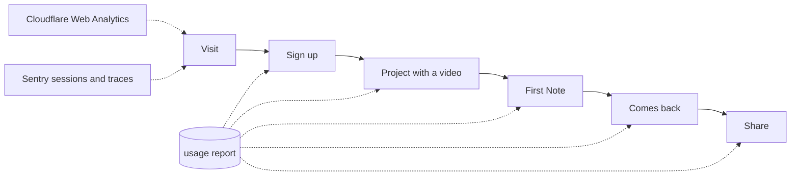

# Product metrics

How to tell whether VideoNote is being used, and what each source can and can't
answer. [Observability](observability.md) covers what's broken; this covers
what's used. The repo is public, so results stay out of it.



## The numbers that matter

| Metric           | Definition                                                      | Source       |
| ---------------- | --------------------------------------------------------------- | ------------ |
| Active noters    | Users who wrote a Note in the last 30 days: the headline number | Usage report |
| Activation       | Share of a month's signups who ever wrote a Note                | Usage report |
| Returning noters | Users who wrote Notes in more than one calendar week            | Usage report |
| Sharing          | Users with at least one Share                                   | Usage report |
| Visits           | Visits, referrers, countries, page load speed                   | Cloudflare   |
| Trouble          | Issues and sessions in production                               | Sentry       |

## Sources

**Usage report.** Reads the table once, slowly, and prints counts. Sample Projects count only under `totals.sampleProjects` and their seeded Notes count nowhere, but a Note a User writes on a sample counts as theirs:

```bash
AWS_PROFILE=personal node scripts/usage-report.mjs videonote-prod
```

A scan of prod uses about 650 read units, paced to 8 a second against 20
provisioned, so it costs nothing extra and takes under two minutes. It holds no ids, emails,
Notes or video links, and leaves out any video host with fewer than 5 Projects.

**Cloudflare.** Web Analytics is on for videonote.app: Cloudflare adds the beacon to
pages as they pass through, and it counts page loads without cookies. Query it,
and the raw request log, with `cf sql query`:

```bash
# page loads by referrer, from browsers that ran the beacon
cf sql query --scope-account <account> "SELECT refererHost, count() c \
  FROM events.rumPageloadEvents WHERE requestHost = 'videonote.app' \
  AND timestamp >= now() - INTERVAL '30' DAY GROUP BY 1 ORDER BY c DESC LIMIT 10 FORMAT TSV"

# every request at the edge, scanners included
cf sql query --scope-zone <zone> "SELECT clientRequestHttpHost, edgeResponseStatus, count() c \
  FROM events.httpRequests WHERE timestamp >= now() - INTERVAL '7' DAY \
  GROUP BY 1, 2 ORDER BY c DESC LIMIT 10 FORMAT TSV"
```

Use page loads for people. Most edge requests are scanners probing for files
such as `/.env` and made-up subdomains.

**Sentry.** `sentry api` reaches session counts and traces. Tracing samples 10% of
requests, so route counts are estimates.

## What can't be answered yet

- **Who came back before `lastSeenOn` existed.** The report's `seen` counts
  Users by the last day they made a signed-in request, so history starts when
  that field went live, and guests reading a Share aren't counted.
- **Where people drop off inside a step**, such as a video that never plays.
- **Why.** These numbers only show what happened. Feedback links reach
  `hello@videonote.app`.
