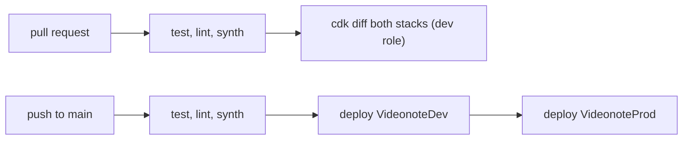

# infra

AWS CDK (TypeScript) for VideoNote's DynamoDB tables and the IAM roles that
reach them. A standalone pnpm package with its own lockfile, so the app's
install and CI don't pull in CDK.

The GitHub and Vercel OIDC identity providers and the CDK bootstrap are
account-wide and live in the private `joshmu/aws-account` repo. These stacks
read the provider ARNs from SSM (`/account/oidc/github/arn`,
`/account/oidc/vercel/arn`) at deploy time, and prod's alarms notify the
account alerts topic (`/account/alerts/topic/arn`), which emails the owner.

## What's deployed

Two stacks in `ap-southeast-2`, built from one `VideonoteStack` class
(`lib/videonote-stack.ts`) with per-environment settings in
`lib/environments.ts`:

| Stack           | Table            | RCU / WCU | Data on stack delete                                        | Vercel role (trusted `sub`)                   | GitHub role (trusted `sub`)                         |
| --------------- | ---------------- | --------- | ----------------------------------------------------------- | --------------------------------------------- | --------------------------------------------------- |
| `VideonoteDev`  | `videonote-dev`  | 2 / 2     | destroyed                                                   | `videonote-dev-vercel` (preview, development) | `videonote-dev-github-deploy` (`environment:dev`)   |
| `VideonoteProd` | `videonote-prod` | 20 / 20   | retained, deletion protection, stack termination protection | `videonote-prod-vercel` (production)          | `videonote-prod-github-deploy` (`environment:prod`) |

- **Table:** `PK` / `SK` strings, provisioned capacity, no secondary indexes,
  no auto scaling, AWS owned encryption key.
- **Vercel role:** trusted only for `aud` `https://vercel.com/joshmu` and
  `sub` `owner:joshmu:project:videonote:environment:<env>`. It may use
  item-level actions (get, put, update, delete, query, batch, transact,
  condition check, describe) on its own table, nothing else. A preview
  deployment can't reach prod data. The app must use the default token
  audience (no custom `audience` in `awsCredentialsProvider`).
- **GitHub role:** trusted only for `aud` `sts.amazonaws.com` and
  `sub` `repo:joshmu/videonote:environment:<env>` or
  `repo:joshmu/videonote-v2:environment:<env>`. It may assume the CDK
  bootstrap roles (`cdk-hnb659fds-*`) and describe stacks.
- **Alarms (prod only):** `videonote-prod-throttled` on any throttled read
  or write in 5 minutes, and `videonote-prod-{read,write}-capacity-high` when
  use stays above 80% of provisioned capacity for 5 minutes. Each notifies the
  alerts topic when raised and when cleared. See
  [`docs/observability.md`](../docs/observability.md).
- **Outputs:** `TableName`, `VercelRoleArn`, `GitHubDeployRoleArn`.

## Capacity budget

DynamoDB's always-free tier is 25 RCU and 25 WCU of provisioned capacity per
region, shared by every table in the account:

| Table            | RCU | WCU |
| ---------------- | --- | --- |
| `videonote-prod` | 20  | 20  |
| `videonote-dev`  | 2   | 2   |
| spare            | 3   | 3   |

Provisioned capacity throttles instead of billing when exceeded. A test
asserts the 22 / 22 total, so raising either table fails CI until the budget
is revisited.

## Environments

| Where                       | `AWS_ROLE_ARN`                 | `DYNAMODB_TABLE` | `AWS_REGION`     |
| --------------------------- | ------------------------------ | ---------------- | ---------------- |
| Vercel Production           | `videonote-prod-vercel`        | `videonote-prod` | `ap-southeast-2` |
| Vercel Preview, Development | `videonote-dev-vercel`         | `videonote-dev`  | `ap-southeast-2` |
| GitHub environment `dev`    | `videonote-dev-github-deploy`  | –                | –                |
| GitHub environment `prod`   | `videonote-prod-github-deploy` | –                | –                |

Vercel OIDC federation is on with the team issuer
(`https://oidc.vercel.com/joshmu`). GitHub's `AWS_ROLE_ARN` values are
environment variables, not secrets. The `prod` GitHub environment only
accepts `main`; it has no approval step, so a merge to `main` deploys prod.

## Commands

From the repo root (`pnpm infra:install` once):

```bash
pnpm infra:test                              # CDK assertion tests
pnpm infra:synth
AWS_PROFILE=personal pnpm infra:diff         # both stacks
AWS_PROFILE=personal pnpm infra:deploy:dev
AWS_PROFILE=personal pnpm infra:deploy:prod
```

Inside `infra/`: `pnpm test`, `pnpm typecheck`, `pnpm lint`, `pnpm format`,
`pnpm cdk:synth`, `pnpm cdk:diff`, `pnpm cdk:deploy <stack>`.

## CI

`.github/workflows/infra.yml` runs when `infra/**` changes:



- PR diffs use the `dev` environment's role for both stacks, because the
  `prod` environment only accepts `main`. The CDK bootstrap roles are
  account-wide, so that role can read (and deploy) any stack: the
  dev/prod split for GitHub deploys rests on who can push to the repo, and
  every change reaches prod through a reviewed PR and its `cdk diff`. Fork
  PRs get no OIDC token.
- The main CI workflow also typechecks, tests and audits `infra/` on every PR.

The GitHub roles live in the stacks they deploy, so the first deploy of each
stack (and any change that breaks its own role) is done from a workstation.

## Point-in-time recovery

Off for now, pending a cost decision (well under $0.01/month at the current
data size). To turn it on for prod, set `pointInTimeRecovery: true` on
`VideonoteProd` in `lib/environments.ts`, update the PITR assertion in
`test/videonote-stack.test.ts`, and deploy.
